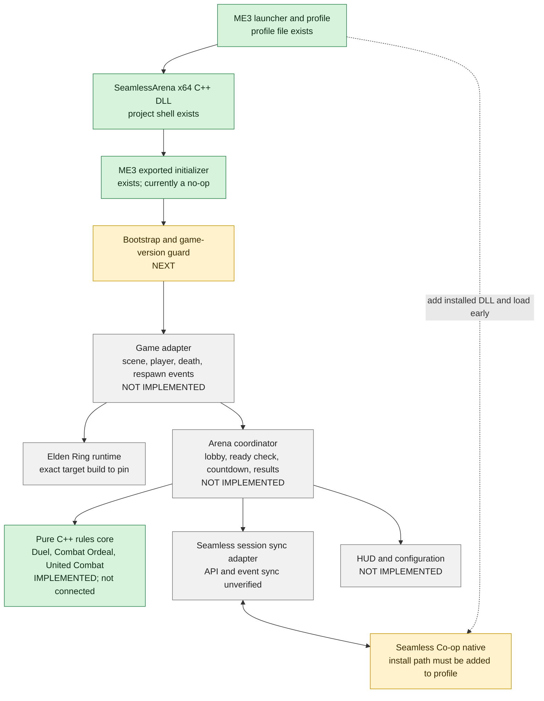

# Architecture proposal

## Runtime shape

The deliverable mod is a native x64 C++ DLL. ME3 loads it through a versioned `.me3` profile and calls the exported `SeamlessArena_Initialize` entry point. To run with Seamless Co-op, the user's profile must also list their installed Seamless DLL as an early native. The checked-in profile currently lists only SeamlessArena because the Seamless install path is machine-specific.

## Architecture and implementation status



**Legend:** green = present in the workspace; yellow = next setup or compatibility task; gray = future implementation or unverified integration. Arrows show the intended design, not a claim that a Seamless plug-in API already exists. The match rules are implemented as standalone logic, but are not wired into the DLL or the game.

## What is done

- Visual Studio 2026 solution with x64 C++20 core and DLL projects.
- Native DLL shell with an inert `DllMain` and exported ME3 initializer.
- `SeamlessArena.me3` profile that points ME3 at the Release DLL.
- Standalone rules for Duel, Combat Ordeal, and United Combat.
- Research notes, architecture boundaries, and phased implementation roadmap.
- Read-only review of the provided Better Multiplayer Rust source; only high-level subsystem organization is used as reference.

## What remains

- Add the installed `ersc.dll` path to the profile and verify ME3 loads both natives in the correct order.
- Pin the exact Elden Ring, Seamless Co-op, and ME3 versions for the first target.
- Add startup logging and a fail-closed game-version check.
- Find safe game events and scene transitions, then implement a minimal game adapter.
- Determine how host-owned match state can be synchronized through a Seamless party.
- Connect the verified events to the C++ rules core and build the two-player Duel slice.
- Add HUD/configuration, respawn modes, teams, and tournament features only after the Duel loop is reliable.

## Recommended order of work

1. **Loader proof:** build the Release DLL, set the real Seamless path in the ME3 profile, and confirm both mods load together.
2. **Compatibility pin:** record game, Seamless, and ME3 versions; log the running game build and refuse unknown builds.
3. **One arena prototype:** make a host party enter and leave one vanilla Colosseum scene together, with no custom score or respawn behavior.
4. **Event and sync proof:** determine how death and match-end events appear to each peer; confirm all clients agree before adding game rules.
5. **Duel vertical slice:** connect start/death/winner/return-to-lobby to the existing rules core.
6. **Expand modes:** implement timed Ordeal and team-based United Combat, then add UI and quality-of-life features.

Stop at each step if the previous one is unstable. In particular, do not build scoring and respawn behavior until scene transitions and shared match state work consistently.

## Boundaries

- **Game adapter:** version checks, scene transition calls, player status, death/respawn events, and UI hooks. It owns offsets and game-specific structs.
- **Arena flow:** state machine and host permissions. Match settings are selected before the match and frozen at start.
- **Rules:** deterministic rules operating on normalized arena events, not raw game memory.
- **Synchronization:** host is the source of truth for lobby state, map/mode selection, timer, score, and match completion. If peers disagree on the match or map, abort and return to the lobby rather than continue desynced.
- **Persistence:** no custom ranking or save-file writes in the first version. This avoids touching character progression and Seamless’s separate save format.
- **Compatibility:** fail closed on an unknown Elden Ring build or Seamless version. Never install hooks after a version check fails.

## Match lifecycle

```text
Idle → Lobby → Ready Check → Countdown → Match → Results → Lobby
  ↑       └────────────── cancel / host leaves ───────────────┘
```

The host creates the lobby, chooses the vanilla arena and mode, assigns teams where relevant, and starts only when the party agrees on a compatible configuration. A disconnect, incompatible state, or host departure cancels cleanly.

## Mode rules to implement

| Mode | Players | End condition | Respawn | Score |
|---|---:|---|---|---|
| Duel | 2 | One player dies | No | Win/loss |
| Combat Ordeal | 2–6 | Match timer expires | Yes | Individual kills/points |
| United Combat | 2–6 | Match timer expires | Yes | Team kills/points |

For six players, United Combat naturally supports 3v3. The first implementation should preserve the vanilla rules and default consumable behavior; quality-of-life options can be added once state synchronization is reliable.

## C++ organization as code grows

```text
src/SeamlessArena.Native/   DLL startup, version gate, game adapter, hooks, UI, sync
src/SeamlessArena.Core/     pure C++ match rules and arena state
```

`SeamlessArena.Core` already contains the game-independent match rules. The DLL stays thin and translates verified game events into core calls. Keep Elden Ring pointers, offsets, and hooks out of the core library.

## Better Multiplayer source review

The supplied reference folder is a Rust `cdylib`, not C++. Its `lib.rs` provides a useful high-level startup/shutdown ordering and subsystem split (networking, patches, file loading, hooks, and optional presence). The inspected EZState, player-limit, release-flag, and file-processor modules mainly flip atomics and log status; they do not implement the described hooks or patches. Treat README/module claims as hypotheses until verified against actual implementations. This project uses the architectural ideas only and keeps all new code in C++.
