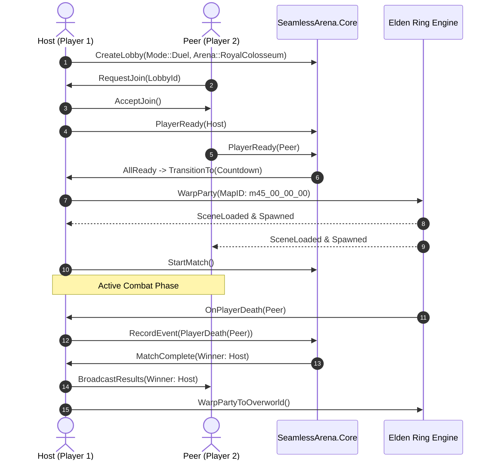

# 01 — Better Multiplayer & DEN Maps Audit

## 1. Context and Objective

The user referenced **Better Multiplayer** (by the creators of DEN Maps) as a key inspiration for PvP combat features in modded Elden Ring. An audit of the reference implementation was conducted to analyze its architectural patterns, match lifecycle, and game hooks, while establishing strict boundaries regarding licensing and code independence.

---

## 2. Reference Implementation Architecture

The inspected reference implementation is structured as a Rust `cdylib` crate targeting `x86_64-pc-windows-msvc`.

### 2.1. Subsystem Decomposition
1. **Lifecycle Orchestration (`lib.rs`):**
   - Implements Windows entry point `DllMain` handling `DLL_PROCESS_ATTACH` and `DLL_PROCESS_DETACH`.
   - Initializes logging, asynchronous runtime, memory patching engines, and network clients in a sequential, deterministic order.
2. **Waygate Client (`waygate-client`):**
   - External networking dependency managing communication with custom external relay/coordinator servers.
   - Provides lobby signaling, matchmaking, and player list synchronization.
3. **Engine Hooks and Patches:**
   - **Player Limit Patch:** Overrides hardcoded player caps (vanilla 4/6 players) in engine memory tables.
   - **EZState Hook:** Intercepts FromSoftware's state machine execution graph (used for animations, event flags, and interaction prompts).
   - **Release Flag Patch:** Modifies debug/release flags inside FromSoftware's task schedulers.
   - **File Processor:** Intercepts game asset loading to inject custom maps and textures.
4. **DEN Maps Data & Assets:**
   - Ships custom `.msb` (MapStudio Binary) and collision files creating bespoke floating arenas, duel platforms, and tournament rings.

---

## 3. Match Lifecycle Comparison

The table below contrasts the Better Multiplayer lifecycle against the **SeamlessArena** architecture:

---

## 4. IP, Licensing, and Clean-Room Policy

### 4.1. Legal & Community Boundary
- **Better Multiplayer / DEN Maps Rights:** The authors have proprietary rights over their custom map assets (`.msb`), models (`.flver`), textures (`.tpf`), and code on Nexus Mods. Redistribution or direct decompilation/copying of DEN Maps assets is prohibited.
- **SeamlessArena Strategy:** 
  1. **Zero Asset Theft:** No DEN Maps files or Rust source code are copied into this repository.
  2. **Clean-Room C++20:** All code is written from scratch in modern C++20 within `SeamlessArena.Core` and `SeamlessArena.Native`.
  3. **Vanilla Assets:** Utilize FromSoftware's built-in Colosseums (`m45_*_00_00`), eliminating the need to redistribute copyrighted game assets.

### 4.2. Design Concepts Adopted vs. Rejected

| Feature / Pattern | Better Multiplayer Approach | SeamlessArena Approach | Rationale |
|---|---|---|---|
| **Programming Language** | Rust (`cdylib`) | C++20 (`MSVC v145`) | Native integration with `me3` and `libER` headers |
| **Arena Venue** | Custom DEN Map files | Vanilla Colosseums | No asset distribution issues, 100% vanilla asset compatibility |
| **Networking Backend** | Custom Waygate relay | Seamless Co-op session | Leverages Seamless party infrastructure without extra servers |
| **Lobby State Machine** | Asynchronous events | Pure deterministic C++ core | High testability, zero desync, zero undefined behavior |
| **Auto-Flask / Physick** | Memory write on round start | Memory hook via `libER` | Restores flasks and applies pre-buffs seamlessly |
| **Anti-Spawn Camp** | Spawn invulnerability flag | Invulnerability timer in core | Prevents immediate killing on respawn in Ordeal modes |
