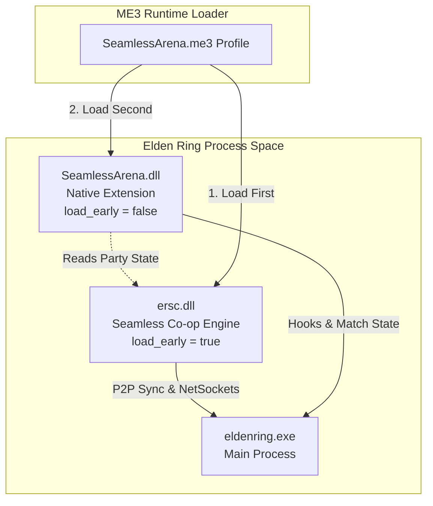

# 02 — Seamless Co-op Integration Boundaries

## 1. Overview

**Seamless Co-op** (by LukeYui/Yui Amoroll) modifies Elden Ring to support a persistent, multiplayer-first PvE experience without the vanilla game's summoning boundaries, fog walls, or post-boss session termination.

**SeamlessArena** is designed to live *inside* this ecosystem as an arena PvP add-on, giving friends and groups playing Seamless Co-op a dedicated, competitive battleground without disrupting their PvE progression.

---

## 2. Seamless Co-op Architecture & Constraints

### 2.1. In-Process Runtime Structure
- **DLL Name:** `ersc.dll`
- **Config File:** `ersc_settings.ini` located in `SeamlessCoop/` directory.
- **Entry Protocol:** Seamless Co-op relies on the Mod Engine extension protocol (`modengine_ext_init`). When ME3 loads `ersc.dll` with `load_early = true`, ME3 calls `modengine_ext_init` prior to FromSoftware's game engine completing its initial boot sequence.
- **Anti-Cheat Isolation:** Seamless Co-op launches with Easy Anti-Cheat disabled, using an offline Steam AppID / Steam socket configuration.
- **Save File Isolation:** Seamless Co-op intercepts FromSoftware save-game I/O, writing player progress exclusively to `*.co2` save files instead of vanilla `*.sl2`.

### 2.2. Network Topology
- **Host-Authoritative P2P:** One player hosts the world session; up to five guest peers join the party via Steam Networking Sockets.
- **Entity Replication:** The host manages world state, enemy spawns, and zone flags. Guest peers replicate position, animation, equipment, and combat damage directly to each other and the host.
- **Session Lifecycle:** 
  - Host opens session via Tiny Great Pot.
  - Guests join via Effigy of Malenia.
  - Leaving party returns guests to their own local save position.

---

## 3. SeamlessArena Integration Strategy

### 3.1. Load Order Contract
1. In the ME3 profile, `ersc.dll` MUST be loaded with `load_early = true`. This guarantees Seamless Co-op establishes its memory hooks, detour trampolines, and save redirects before any other code runs.
2. `SeamlessArena.dll` loads as a standard native DLL immediately following `ersc.dll`.
3. In `SeamlessArena_Initialize`, our code checks for the presence of `ersc.dll` in memory using `GetModuleHandleA("ersc.dll")`.
   - If present: Proceed with Seamless party synchronization hooks.
   - If absent: Log diagnostic warning and run in local offline/practice mode or gracefully disable arena triggers.

### 3.2. Data Isolation & Safety Guarantees
- **No Save Interference:** SeamlessArena performs zero save file writes. Player levels, inventory, runes, and progression are never persisted by SeamlessArena.
- **Consumable Reversion:** Any flasks, consumables (boiled crab, arrows, greases), or runes expended during an arena match should be restored upon match conclusion to avoid depleting the player's PvE resources.
- **Safe Warp Boundary:** When teleporting players into or out of Colosseums, SeamlessArena uses the host's existing world-travel broadcast so all players in the party transition synchronously without triggering Seamless desync disconnects.

---

## 4. Failure Modes and Recovery

| Condition | Observed Behavior | SeamlessArena Mitigation |
|---|---|---|
| `ersc.dll` missing from profile | Player running without Seamless | Log notification, disable multiplayer party features |
| Mismatched Seamless versions | Peers cannot join Seamless session | Seamless handles rejection; SeamlessArena stays idle |
| Peer disconnects mid-match | Guest crashes or leaves Steam | Core state machine triggers `HandlePlayerDisconnect()`, awards forfeit win or resets match |
| Host aborts / leaves | Host crashes or leaves game | Guest resets local match state, warps safely to overworld Site of Grace |
