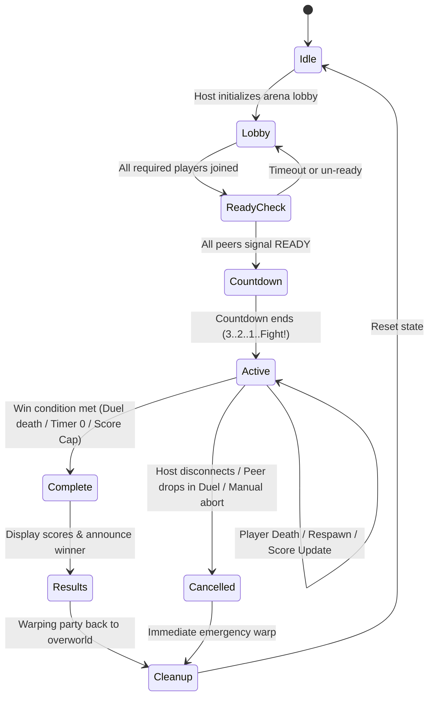

# 06 — PvP Match Rules, State Machine & Mode Specifications

## 1. Overview

The core gameplay rules of SeamlessArena are implemented in `SeamlessArena.Core` as a standalone, deterministic C++20 state machine (`MatchRules`). It does not contain any game pointers, memory offsets, or DirectX/Windows dependencies, making it 100% unit-testable.

---

## 2. Supported Game Modes

| Mode | Players | Duration | Respawns | Win Condition | Scoring |
|---|---|---|---|---|---|
| **Duel** | 2 | 300s (5 min) | No | First death ends match. Surviving player wins. | 1 point on victory |
| **Combat Ordeal** | 2–6 | 180s - 300s | Yes | Highest kill count when timer reaches 0. | +1 per kill, -0 on suicide |
| **United Combat** | 2v2 or 3v3 | 300s | Yes | Team with highest cumulative score at timer expiration. | +1 to team per kill |

---

## 3. Match State Machine

### 3.1. Detailed State Definitions

1. **`Idle`:** Mod is dormant; players are in normal Seamless Co-op PvE session.
2. **`Lobby`:** Host selects Mode (Duel, Ordeal, United Combat) and Arena (`Limgrave`, `Royal`, `Caelid`). Peers are assigned to slots and teams.
3. **`ReadyCheck`:** Host requests confirmation. Peers acknowledge readiness.
4. **`Countdown`:** Players freeze in place at spawn points with camera unlocked; a 3-second countdown banner is presented.
5. **`Active`:** Combat is active. Movement and attacks enabled. Damage registers towards score.
6. **`Complete`:** Win condition triggered. Combat inputs are disabled. "VICTORY" or "DEFEAT" banner is triggered.
7. **`Results`:** Final scores, kills, and deaths displayed on screen for 5–10 seconds.
8. **`Cleanup`:** Flasks and consumables are replenished, and players are warped to the overworld hub.

---

## 4. Combat Restrictions and Balance Rules

To provide a tournament-grade vanilla duel experience:
- **Crimson Flasks:**
  - *Duel Mode:* 0 Crimson Flasks (or locked to vanilla duel rules of 0 healing flasks) to prevent endless attrition.
  - *Combat Ordeal / United Combat:* Restricted to 1 or 3 flasks per life, replenished upon respawn.
- **Cerulean Flasks (FP):** Allowed across all modes (e.g., up to 3 per life) to support caster and weapon-art builds.
- **Wondrous Physick:** 
  - Automatically consumed/activated or enabled during countdown.
  - Crimson Bubbletear / healing tears disabled or standardized by configuration.
- **Great Runes:** Disabled during arena combat to ensure equal footing.
- **Consumable Restoration:** All boiled crab, exalted flesh, throwing pots, and boluses consumed during the match are refunded upon match exit to prevent inventory attrition.
- **Anti-Spawn Camping:** Upon respawning in Ordeal or United Combat, players receive 3.0 seconds of invulnerability (SpEffect flag) which expires immediately if the player inputs an attack or offensive spell.

---

## 5. Tie-Breaker and Edge Cases

- **Simultaneous Death (Duel):** If both players die within a 100ms tick window, the match is evaluated as a `Draw` (`isDraw = true`), and neither player is awarded a victory point.
- **Score Tie (Combat Ordeal / United Combat):** If time expires with tied top scores, the system enters a 60-second **Sudden Death** round; first subsequent kill wins the match.
- **Peer Disconnection:**
  - In *Duel*: The disconnected player forfeits; remaining player wins.
  - In *United Combat*: Match continues unless an entire team disconnects.
