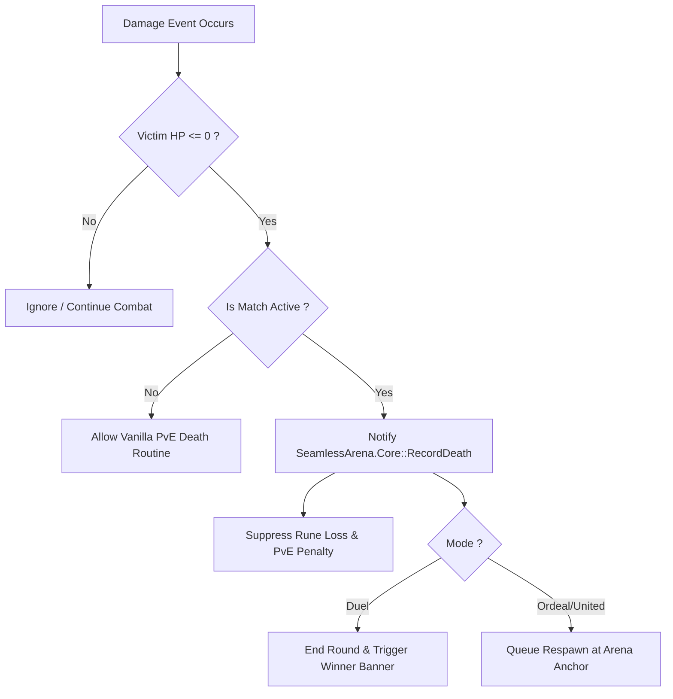

# 08 — Game Events, Engine Hooks & Memory Detours

## 1. Overview

To synchronize match rules with Elden Ring's runtime, `SeamlessArena.Native` attaches minimal, non-invasive memory hooks into FromSoftware engine routines.

All hooks follow these design rules:
- **No byte-patching in critical loops without trampolines:** Use battle-tested detour libraries (e.g. MinHook).
- **Read-only observation where possible:** Prefer reading game singletons on frame ticks over intercepting execution.
- **Fail-closed verification:** Before attaching, verify the target instruction bytes match the expected signature. If a single byte differs, abandon hook installation and log the failure.

---

## 2. Key Hook Targets

| Target Event | Function / Location | Purpose | Signature / Hook Method |
|---|---|---|---|
| **Player Death** | `ChrDeadEvent` / `PlayerIns::OnDeath` | Detect when any player's HP reaches 0 and trigger round scoring. | MinHook detour on character death handler. |
| **Character Damage / HP** | `CalcDamage` / `ApplyDamage` | Track who dealt the killing blow to award kill credits accurately. | Inspect attacker entity ID before death transition. |
| **Map Scene Change** | `FieldArea::LoadMap` | Detect when arena scene finishes loading so countdown can begin. | Hook map loading state transition callback. |
| **World Tick** | `from::CS::CSEzTask` (`CSTaskGroup::FrameBegin`) | Execute per-frame match coordinator updates, timers, and packet processing on the game thread. | Native FromSoftware task scheduler callback (`eztask_execute`) via libER. Zero byte-patching needed. |
| **Menu / Banner Trigger** | `CSMenuMan::ShowBanner` | Trigger native "VICTORY", "DEFEAT", "DRAW" splash screens. | Direct function call via resolved libER symbol. |

---

## 3. Death Event Detection Strategy



### 3.1. Hook Implementation Example (C++ MinHook)

```cpp
// Target pointer and original trampoline
typedef void(__fastcall* tChrDeadEvent)(void* chrIns, void* killerChrIns);
tChrDeadEvent oChrDeadEvent = nullptr;

void __fastcall HookedChrDeadEvent(void* chrIns, void* killerChrIns) {
    if (g_ArenaCoordinator.IsMatchActive()) {
        uint64_t victimId = GetPlayerSteamIdFromChr(chrIns);
        uint64_t killerId = killerChrIns ? GetPlayerSteamIdFromChr(killerChrIns) : 0;
        
        g_ArenaCoordinator.OnPlayerDeath(victimId, killerId);
        
        // Prevent vanilla death screen and rune drop if in Arena Duel
        if (g_ArenaCoordinator.ShouldSuppressVanillaDeath()) {
            // Set HP to 1 or enter spectator state rather than reloading entire overworld
            return;
        }
    }

    // Call original function
    oChrDeadEvent(chrIns, killerChrIns);
}
```

---

## 4. Respawn and Camera Control

In **Combat Ordeal** and **United Combat**:
- When a player dies, instead of triggering the 30-second overworld reload sequence, SeamlessArena hooks the death camera.
- The player character is revived in-place at an allocated arena spawn region (`m45_*_00_00`).
- HP and FP are restored to maximum.
- A temporary invulnerability SpEffect (e.g. `SpEffectParam 10100` or equivalent) is applied for 3 seconds.
- The player re-enters combat seamlessly within 3 to 5 seconds.
