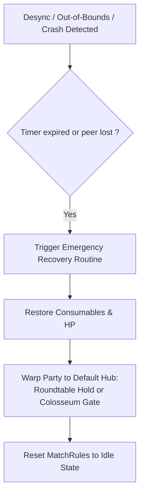

# 09 — Configuration, Diagnostics Logging & Emergency Recovery

## 1. Configuration File Specification

SeamlessArena uses an intuitive, human-readable TOML configuration file: `SeamlessArena.toml` placed adjacent to the DLL or in the ME3 mod folder.

### 1.1. Schema & Default Values

```toml
[general]
# Enable debug console and detailed logging (trace, debug, info, warn, error)
log_level = "info"
auto_check_updates = false

[rules.duel]
# Duration in seconds (default: 300 = 5 minutes)
duration_seconds = 300
# Crimson Flasks permitted (0 recommended for tournament integrity)
max_crimson_flasks = 0
# Cerulean Flasks permitted
max_cerulean_flasks = 3
# Auto-restore consumed items upon exiting match
restore_consumables = true
# Automatically activate Wondrous Physick on countdown end
auto_physick = true

[rules.ordeal]
duration_seconds = 300
score_limit = 10
respawn_delay_seconds = 4
spawn_invulnerability_seconds = 3.0

[rules.united_combat]
duration_seconds = 300
score_limit = 15
friendly_fire = false

[arena]
# Default Colosseum: "royal", "caelid", or "limgrave"
default_colosseum = "limgrave"
allow_spirit_ashes = false
```

---

## 2. Diagnostics & Logging Subsystem

SeamlessArena writes structured log output to `SeamlessArena.log`.

### 2.1. Log Levels & Formatting
```text
[2026-10-17 19:30:15.123] [INFO]  [Bootstrap] SeamlessArena v0.1.0 initializing under ME3.
[2026-10-17 19:30:15.125] [INFO]  [VersionGuard] Elden Ring v1.16 verified (TimeDateStamp: 0x66B12401).
[2026-10-17 19:30:15.130] [INFO]  [SeamlessGuard] ersc.dll detected at base 0x7FFB20400000.
[2026-10-17 19:30:20.400] [DEBUG] [HookManager] Detour attached to ChrDeadEvent at 0x7FF7E14A89B0.
[2026-10-17 19:31:02.100] [INFO]  [MatchFlow] Lobby created: Mode = Duel, Arena = Limgrave Colosseum.
```

### 2.2. Thread-Safety
The logger writes to a lock-free ring buffer flushed periodically by a background worker thread, ensuring logging calls never hitch or stall the main game rendering thread.

---

## 3. Emergency Recovery & Anti-Stranding Safeguards

A major risk in modded arena teleports is players getting trapped inside closed collision geometry if a crash or desync occurs.



### 3.1. Automatic Triggers for Emergency Recovery
1. **Host Departure / Crash:** If the host drops, guest clients automatically trigger local recovery warp after 10 seconds.
2. **Fall Out of Bounds:** If a player's coordinates drop below the arena floor kill plane (`Z < -150.0m`), the player is immediately respawned onto the center spawn pad rather than infinitely falling into the void.
3. **Emergency Console / Keybind:** Pressing `F8 + F9` immediately aborts any active arena match and warps the local player to the nearest Site of Grace.
