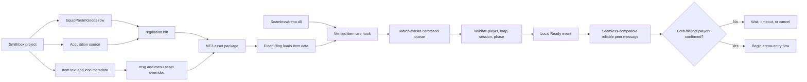

# 12 — Custom Duel Item to C++ Hook: Research and Implementation Plan

**Research date:** 2026-10-18  
**Scope:** Elden Ring + Seamless Co-op + ME3 + SeamlessArena native C++ DLL  
**Question:** How can a new in-game item be added so that using it invokes the Duel confirmation logic in SeamlessArena?

## Findings

An Elden Ring item does not directly call an arbitrary function exported by a mod DLL. The item is game data. The DLL must separately observe the game's item-use path, recognize the custom item's goods ID, and hand a validated event to SeamlessArena's match coordinator.

The architecture is therefore two connected parts:

1. **Game data package:** defines the item in `EquipParamGoods`, its localized text and icon metadata, and a way for each player to obtain it. ME3 loads these files as asset overrides.
2. **Native C++ behavior:** hooks a verified item-use function (or observes a verified equivalent event), filters for the custom item ID, queues a command to the game thread, and records that this participant confirmed the duel.

The existence and exact address/signature of the Elden Ring item-use callback are **not verified yet** for the project's target executable. No hook should be enabled until it is identified and checked against the supported game build.

## Data path and runtime path



**Important boundary:** The item definition does not contain a pointer or callback to `SeamlessArena_Initialize`. That ME3 export is only the DLL bootstrap entry point. The item-use hook is a separate runtime hook installed by the DLL.

## 1. Define the custom item in game data

### 1.1 `EquipParamGoods`

Create a new Goods row in Smithbox by duplicating a suitable existing, simple consumable row and changing only the fields needed for the duel item. This preserves valid defaults for fields whose meaning has not yet been established. The custom goods ID must be selected only after checking the target game's current regulation data for an unused, supported row ID; do not guess an ID or overwrite a live vanilla/Seamless item.

For the first proof of concept, the item should:

- Be usable from the player's normal quick-item interface.
- Have a distinct, stable goods ID compiled into the DLL configuration/constants.
- Avoid healing, damage, buffs, teleport effects, or other unrelated vanilla effects.
- Have a deliberately chosen consumption policy. The alpha requires the same item to be available for both confirmation and later rounds, so a one-use consumable is likely wrong; verify the exact Goods fields and behavior in Smithbox before deciding how to make it reusable.
- Be allowed in the relevant session and arena context. Verify the row's arena, online, and multiplayer-use flags instead of assuming vanilla defaults.

Do not invent an effect or animation binding to force a DLL callback. First find a vanilla Goods row whose use action is safe and observable, then establish what the corresponding fields do in the current regulation schema.

### 1.2 Text and icon

Add a clear name and short description in the appropriate item message FMG entries, and assign an icon ID that resolves to a valid icon asset. A placeholder vanilla icon is acceptable for the first hook proof; custom art can follow once the behavior works. Missing message rows commonly display placeholder text, and missing icon assets can leave the item visually incomplete without proving anything about the hook.

The exact message bundle/FMG names and icon asset paths should be confirmed in the current Elden Ring project opened by Smithbox. The Souls Modding EMEVD guide identifies item text under `item.msgbnd.dcx` / `menu.msgbnd.dcx` and explains that item acquisition is tied to item lots and scripted references. Smithbox supports editing params and text and reading the game's data without first unpacking it.

### 1.3 Give both testers a way to obtain it

An item row alone does not put the item in either inventory. For testing, choose one explicit acquisition route:

- A temporary shop entry, if adding a shop row is the least invasive test path; or
- A temporary item lot/event placed at a controlled test location; or
- A C++ inventory grant only if SeamlessArena has a verified, safe inventory API for that operation.

Do not implement a permanent shop, chest, or runtime inventory write until the team chooses the distribution design. The custom item and its assets must be present for both players in the Seamless session; mismatched game data can cause inconsistent item use or session problems.

## 2. Load the data with ME3

ME3 profiles can load asset packages and native DLLs in the same profile. The item data belongs in a package directory matching Elden Ring's asset hierarchy (for example, `regulation.bin` and the relevant `msg/...` and `menu/...` overrides); SeamlessArena remains a native entry in `[[natives]]`. This means “C++ only” can describe the executable logic, but a genuinely new item still needs game-data/asset files. A DLL-only implementation has no verified way in this project to create a persistent, fully named/iconed Goods row in the live game.

Both players need the same compatible item data and the same SeamlessArena DLL version. Keep the DLL and data package in the same ME3 profile, and verify the loaded asset paths in the ME3 log before debugging the hook.

## 3. Find the real item-use event before implementing it

The required runtime event is **“the local player has actually begun/committed use of Goods ID X”**, not merely “Goods ID X is selected in the HUD.” Selection changes would create false confirmations.

Research and verify one of these approaches, in this order:

1. Find an Elden Ring player item-use/action function called when a Goods use request is accepted. Determine its arguments, calling convention, return behavior, and whether it runs on the game thread.
2. If there is no suitably safe function boundary, identify a reliable game-thread state transition that unambiguously reports the Goods ID actually used. A reverse-engineered `ChrIns` layout documents `tae_queued_use_item` as being used by TAE's `UseGoods`, which is a lead for investigation, not proof that polling it is a safe or complete event API.
3. Use a known vanilla test item first. Log the local player pointer/state and Goods ID at the event, then compare the result with selecting an item without using it. Only after this event is reliable should the custom item data be introduced.

For the selected target:

- Identify it on the exact supported Elden Ring executable with IDA/Ghidra and/or existing symbols/signature databases.
- Record the executable version, module-relative offset or robust signature, expected bytes, function prototype, and evidence for each argument.
- Check that it is called for local item use and not for equipment selection, remote-player replication, menu preview, or unrelated goods.
- Use a fail-closed signature/version guard. If the target differs or arguments cannot be validated, leave the feature disabled and log why.
- Keep the hook small. It should copy the item ID and validated participant identity into a queue; it should not warp, mutate inventory, or perform network I/O inside the detour.
- Call the original function exactly as required by its verified semantics. Suppress vanilla behavior only if the custom Goods row is otherwise shown to produce an unsafe or undesired effect, and only after a controlled proof.

The loaded `libER` project can help inspect game types, task scheduling, and runtime interfaces. Its API does not by itself prove that the desired item-use hook exists or remains compatible with a particular game patch.

## 4. Bridge the use event to the alpha duel flow

The native event should become a command such as `LocalDuelItemUsed(playerId, goodsId, mapId, sessionState)`. Process it from the existing game-thread task/coordinator path after validating:

- `goodsId` equals the configured Duel Item ID.
- The actor is the local player and maps to one nonzero Seamless participant ID.
- Seamless Co-op is active and the party contains exactly the two distinct participants allowed for this alpha.
- The player is on the intended Royal Colosseum full-detail map (`m45_00_00_00`) if the design requires confirmation at the arena. If item use is meant to summon both players into the arena from elsewhere, map validation must instead be performed after the verified travel flow.
- The coordinator is in a phase that accepts a ready confirmation; duplicate uses are idempotent.

The two local clients each send a Ready message through a **verified** Seamless-compatible networking route. A client-side item hook alone cannot prove the other player's intent. The host/authority validates two distinct, current participants, matching arena/session/match nonce, and ready-state timeout, then moves the match into its next phase. Do not treat item use as host authority or assume the other peer receives a native item-use callback.

Suggested flow:

```text
Idle -> ReadyCheck -> AwaitingArena -> Countdown -> RoundActive
                   ^               (when both item uses are confirmed)
RoundActive -> RoundBreak -> RoundActive -> ... -> Results
```

The requested best-of-three behavior means first to two round wins. `MatchRules` and `ArenaCoordinator` currently implement a single-death duel (`scoreLimit = 1` and “first death ends match”), so that existing prototype must be changed before this item can start the agreed alpha match. Respawning both players and restoring their agreed round-start state is a separate runtime feature; the item-use hook must not attempt to implement it.

## 5. Safe implementation boundaries

- Keep the Goods ID in one shared C++ constant/config value; record the corresponding Smithbox row ID beside the data project.
- Add an explicit `Hook_DuelItemUse` installation result. If it is missing or unverified, SeamlessArena stays in Safe Idle and installs no partial gameplay hooks.
- Never run match transitions from `DllMain`, the ME3 initializer, an arbitrary render callback, or a network callback. Queue the request for the verified game thread.
- Do not allow remote actor state, an item-selected state, or a replayed Ready packet to confirm the local player's intent.
- Make confirmation idempotent and time-bounded. Define cancellation/timeout before enabling a persistent lobby.
- Preserve the vanilla item-use path for every Goods ID except the dedicated custom ID.
- Keep temporary acquisition edits out of the final release until the distribution method is selected.

## 6. Concrete research and build tasks

1. **Record the exact test build:** Elden Ring executable version/hash, ME3 version/profile, Seamless Co-op version, and current regulation base.
2. **Inspect Goods rows in Smithbox:** shortlist a safe base row, inspect all use/multiplayer flags and effects, find a non-conflicting custom goods ID, and export/save a disposable test regulation.
3. **Prove localization/icon wiring:** add a temporary name/description and reuse a known-good icon; ensure ME3 loads the matching `msg`/`menu` overrides.
4. **Prove acquisition:** create a temporary, documented way for both test players to obtain the Goods. Do not use a permanent save editor path as the alpha design.
5. **Reverse-engineer the use event:** identify candidate functions/state using a known vanilla test item; distinguish use from selection; document prototype, thread, and signature evidence.
6. **Create a hook-only prototype:** log only the local test Goods ID and return to vanilla behavior. Verify no false positives, crashes, or repeated events.
7. **Add the coordinator bridge:** queue a local Ready command, validate state, and test duplicate use and invalid phases without starting a match.
8. **Verify peer confirmation:** use the supported Seamless message mechanism, confirm each peer's own item use, and reject duplicate/stale messages and disconnects.
9. **Implement full alpha round loop:** update the single-death match rule to best of three, then implement round respawn/reset and result cleanup as separately verified work.
10. **Package and test as a pair:** both clients use the same ME3 profile and matching assets/DLL; test one-player confirmation, two-player confirmation, timeout, cancellation, wrong item, wrong map, disconnect, and DLL Safe Idle.

## 7. Acceptance criteria for the item-to-hook slice

This slice is complete only when:

- Both players can see and obtain the same named/iconed custom item under the test ME3 profile.
- Selecting it does not confirm readiness; actually using it produces exactly one local Ready event.
- Other Goods IDs continue to behave as vanilla.
- Ready is rejected outside the allowed match/session/map state and cannot be duplicated by repeated inputs.
- The first player alone does not start a duel; the second distinct player's valid confirmation advances the authoritative flow.
- A missing or mismatched hook signature leaves the DLL safely idle with a clear log message.
- The behavior has been verified in a two-player Seamless Co-op session, not only with a local single-player log.

## Project-specific status

- ME3 successfully loads `SeamlessArena.dll` and calls `SeamlessArena_Initialize` in the user's latest log.
- `HookManager` currently contains stub/unverified gameplay hook implementations. Item use is not presently connected to a verified callback.
- `ArenaCoordinator` currently starts a single-death Duel and uses placeholder engine/network bridges. It does not yet implement best-of-three, arena travel, or the agreed two-player item-ready check.
- Existing hook research: [`08-game-events-hooks.md`](08-game-events-hooks.md). Existing architecture notes: [`../docs/architecture.md`](../docs/architecture.md) and [`../docs/TODO.md`](../docs/TODO.md).

## Sources

- [ME3 ModProfile configuration reference](https://me3.help/en/v0.9.0/configuration-reference/) — asset packages, native DLLs, initializer, load ordering, profile fields.
- [ME3 guide: Creating mod profiles](https://me3.help/en/v0.7.0/user-guide/creating-mod-profiles/) — placement of `regulation.bin` and loose asset overrides alongside DLLs.
- [Smithbox repository README](https://github.com/vawser/Smithbox) — Param Editor, Text Editor, file browser, and game-data access without unpacking.
- [Souls Modding: Intro to Elden Ring EMEVD](https://soulsmodding.wikidot.com/tutorial:intro-to-elden-ring-emevd) — locating item text, item lots, shops, and tracing item references.
- [Elden Ring Rust API docs: `ChrIns` source](https://docs.rs/eldenring/latest/src/eldenring/cs/chr_ins.rs.html) — reverse-engineered layout notes, including `tae_queued_use_item`; treat as a lead, not a supported FromSoftware API.
- [libER repository](https://github.com/Dasaav-dsv/libER) — C++ runtime API reference project used by SeamlessArena.
- [RadialMenu DLL mod](https://github.com/LorenzoFerri/RadialMenu) — a current Elden Ring/ME3 C++ DLL example that reads item metadata and installs game hooks; it does not document the custom item-use callback required here.
- [ME3 repository](https://github.com/garyttierney/me3) — loader source and release history.

## Confidence and limitations

High confidence: ME3 can load a regulation/data package and a native DLL in the same profile; item data and native behavior are separate concerns; text/item-lot references live in game data; the project currently lacks a verified item-use hook.

Medium confidence: `EquipParamGoods` plus message/icon data is the correct starting point for a custom Goods item, and a verified native use hook can bridge its ID to the C++ coordinator. This is established modding practice but still needs an in-game test on this exact project/game build.

Unverified: a collision-free custom Goods ID, exact fields and asset paths for the selected item, a no-consume configuration, the exact item-use function/signature, a safe way to acquire the item, and a supported Seamless peer message API. Resolve these before treating the design as implemented.
